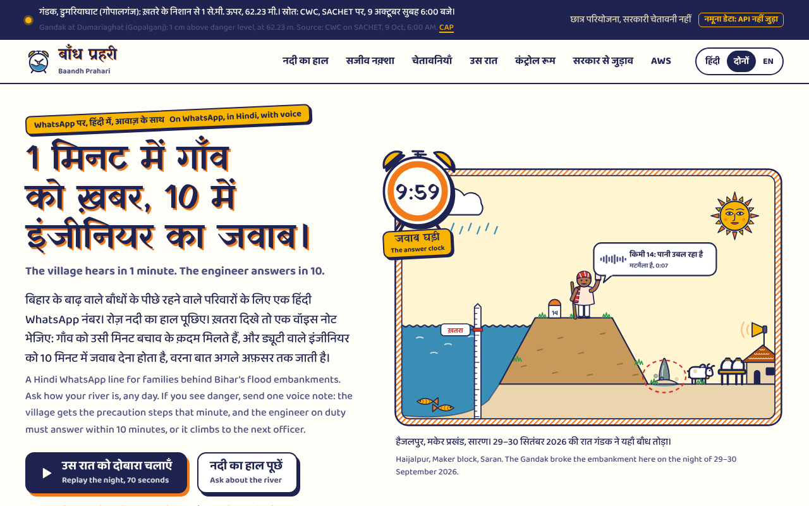
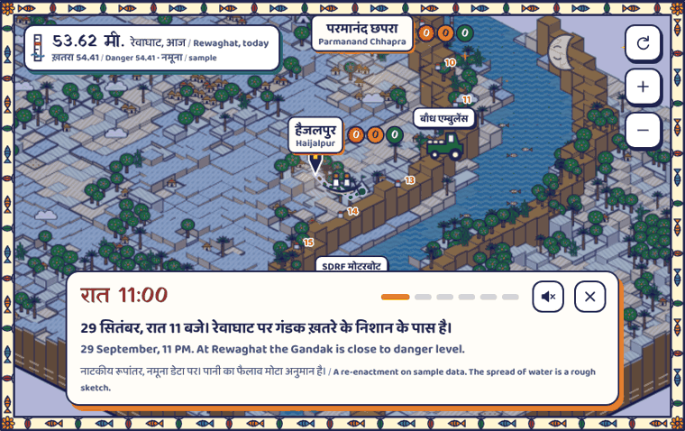

# Baandh Prahari (बाँध प्रहरी)

**A Hindi WhatsApp line for families behind Bihar's flood embankments. Ask how your river is, report danger in one voice note, and get the right precaution step within a minute. The engineer on duty must answer within 10 minutes, or the warning climbs to the next person.**

[](https://github.com/its-aryansingh/bandh_prahari/actions/workflows/ci.yml)
[](LICENSE)
[](template.yaml)
[](docs/architecture.md)

**Live page:** _add the Amplify URL_ · **Video (3 min):** _add the YouTube link_ · Environmental Hacks (WeMakeDevs × AWS), Heat and Water track

> A student project. It has no government affiliation, it is not an official warning service, and every public alert it drafts is marked **Exercise**. In an emergency call **1070** or the Water Resources Department's helpline **1800 345 6145**.



## The night it's built for

On the night of 29–30 September 2026 the swollen Gandak broke its embankments at **Haijalpur** (Maker block, Saran) and **Sheetalpur** (Baikunthpur block, Gopalganj). Officials cited "seepage and piping at several locations": the bank warned before it broke. On 4 October the Water Resources Department suspended seven engineers, saying some "left the breach sites instead of responding immediately", and that coordination with residents was weak.

Bihar already has the parts: one patrol worker per kilometre on 3,808 km of embankments, repair tractors on standby, control rooms and a helpline. What's missing is the wiring between them: nothing timed, escalating and recorded runs from the person who sees the danger to the person who must act, and to the people who must move.

**Jawab Ghadi (जवाब घड़ी), the answer clock**, is that wiring. Every warning gets an owner, a deadline and a next person if the deadline passes.

## Try it in 60 seconds

On the live page, with no login and no WhatsApp:

1. **"रात दोबारा चलाएँ / Replay the night"**: 29–30 September at Haijalpur, the whole night in about 70 seconds. The report, the page, the silence, the climb, the answer, the Hindi "get ready", the village marking "Ho gaya".
2. **"उस रात को नक़्शे पर चलाएँ / Play that night on the map"**: the same night on the Mithila map built from AWS Open Data satellite layers. The river climbs, the bank gives way at km 14, water fills the Saran side, a family asks for a boat and the nearest relief team goes on a 20-minute clock.
   The map is **3D** (WebGL), built only from real data: Copernicus DEM ground, every one of the ~39,000 building footprints, roads, bridges and public places in the 11 × 10 km window (Overture Maps on AWS Open Data), trees from ESA WorldCover, and Sentinel-2 water and photos from before the breach (20 Sep) and after it (6 Oct). For a district patrol desk it shows each open incident as a column of light over its kilometre with the answer clock's minutes left, and the patrol at every kilometre stone turning from green to the incident's colour.
3. **"रन शुरू करें / Start a run"** in the judge panel: a real AWS Step Functions run in Mumbai, with phones drawn on the page and one-minute clocks. Don't answer and watch it climb, then answer from the next phone. The panel shows the execution history straight from AWS.
4. **On WhatsApp** (_add the number_): send a village name such as "Haijalpur" for today's official river reading in Hindi, or `TEST` to play patrol worker and engineer on one-minute clocks.



Locally, with sample data and no AWS account: `cd web && npm ci && npm run dev`, then open http://localhost:5173.

## What happens in one incident

```
patrol worker: voice note + photo ──▶ WhatsApp (AWS End User Messaging Social) ──▶ SNS ──▶ intake Lambda
                                           returns at once, dedupes on the message ID
                                                        │
              six-sign list, one tap ──▶ src/rules/priority.py   (plain rules set P1/P2/P3; nobody can lower one)
                                                        │
                      AWS Step Functions (Standard): the answer clock, statemachine/incident.asl.json
   P1 ─▶ "get ready" to the mukhiya, ward members and subscribed families, at once, without waiting
     └─▶ page the junior engineer ── waitForTaskToken, 10 min ──▶ "on my way"? ── yes ─▶ on site ─▶ close + record
                                    no answer, or no delivery receipt in 2 min
                                      └─▶ assistant engineer ─▶ executive engineer + district ─▶ flood-fighting force
   every step ─▶ DynamoDB timeline + S3 Object Lock record ─▶ the public page, the district, the relief list
```

The same clock runs relief: a family's "मदद" (help) goes to the nearest free team; "मैं जा रहा हूँ" (on my way) starts 20 minutes; a late team brings in the next one and tells the district; "सुरक्षित" (safe) closes it.

## What's built, and what's next

| Part | State |
| --- | --- |
| The answer clock (page, climb, answer, warn, close), the judge path, the control-room form for helpline calls | Built, tested |
| SACHET's Bihar alerts and the department's gauges in; GloFAS as the fallback; "Nadi ka haal" in Hindi | Built, tested on real captured responses |
| CAP 1.2 alert drafts out, always status Exercise, checked against the OASIS schema | Built, tested |
| WhatsApp through AWS End User Messaging Social, with delivery receipts; Telegram switchable | Built, tested |
| The public page: replay, live map, four warning levels, control room, government and AWS views, Hindi first | Built |
| Help requests and relief teams on the server: the help run on the same clock, team positions on an Amazon Location tracker | Built, tested |
| Voice notes (Transcribe and the Strands drafter), Polly clips, geofence check-ins, roll-call, IRS Form 001 briefing | Next, in that order of cutting |

`pytest -q`: 140 tests pass, including real captured SACHET, FMISC, Open-Meteo and Step Functions responses. `sam validate --lint` passes.

## Where AWS fits

Everything runs in Mumbai (ap-south-1), in one SAM template.

| AWS service | Its one job | Where |
| --- | --- | --- |
| AWS End User Messaging Social | A real WhatsApp number run from AWS; messages and delivery receipts arrive on SNS | `src/channels/whatsapp.py`, `src/intake/` |
| Amazon SNS (KMS-encrypted) | Inbound messages and status events | `template.yaml` (InboundTopic) |
| AWS Step Functions (Standard) | The answer clock: each page waits for a task token, then climbs. Its history is the audit trail | `statemachine/incident.asl.json`, `src/incident/` |
| AWS Lambda (Python 3.12, arm64) | Intake, rules, paging, answers, warnings, feeds, the API: 18 functions, one least-privilege role each | `src/` |
| Amazon DynamoDB | Incidents, timelines, wait IDs for task tokens, gauges, alerts, subscriptions | `src/common/db.py` |
| Amazon S3 with Object Lock | A record nobody can quietly change after a breach | `template.yaml` (Bucket) |
| Amazon EventBridge Scheduler | SACHET every 15 minutes, the gauges every three hours, GloFAS daily; the two-minute delivery check after each page | `src/gov/`, `src/river/poll.py`, `src/incident/delivery.py` |
| Amazon API Gateway (HTTP API) | The public page, the judge path and the CAP feed, throttled | `src/api/` |
| AWS Systems Manager Parameter Store | Roster phone numbers and role tokens, never in git | `data/roster.json` names them |
| AWS KMS, Amazon CloudWatch Logs | Encryption; every log group kept 180 days | `template.yaml` |
| AWS Amplify Hosting | The public page | `web/` |
| AWS Open Data | The live map: Copernicus DEM, ESA WorldCover, Sentinel-2 L2A via Earth Search (`tools/build_map.py`); Overture Maps buildings, roads, bridges and places (`tools/build_features.py`) | `web/src/map/view3d.ts` |
| Amazon Location Service | Relief teams' positions on a tracker, and a 200 m geofence round each family's pin | `src/teams/position.py`, `statemachine/help.asl.json` |
| Next: Amazon Transcribe, Amazon Bedrock with Strands Agents (AWS open source), Amazon Polly | Hindi voice notes, drafts, voice warnings | `docs/SPEC.md` |

Details and the diagram: [docs/architecture.md](docs/architecture.md).

## Safety model

The rules are in code and IAM, not in a prompt. Details: [docs/safety.md](docs/safety.md).

1. **Arithmetic decides, the AI only drafts.** `src/rules/priority.py` sets priority from the sign and the river; a test covers every row. Engineers can raise a priority, never lower it. The model never sets one.
2. **Nothing official is ever sent.** Every CAP alert is status `Exercise` with a headline starting "Demo, not a real warning". Nothing goes to SACHET or any government system.
3. **One switch stops every message to a real phone** (`Outbound=off`), and only numbers on the demo roster can ever get a page or a warning. Real users get "Nadi ka haal" and nothing else.
4. **The judge path can't touch a real run.** It uses the fictional roster, draws its phones on the page, is rate-limited, and can't answer a real incident's task token.
5. **Privacy (DPDP Act 2023).** No names in help requests, and their phone numbers only as SHA-256. A number that subscribes to warnings is kept with a consent note, only for this season's warnings. The public map shows counts per village, never pins; team positions come only from team phones on duty.
6. **Least privilege, India-resident, kept.** One role per function, data in ap-south-1, logs kept 180 days as CERT-In's directions ask.

## Evidence

| Measure | Value |
| --- | --- |
| Tap to first page (median, worst), five judge-path runs | _from `make evidence`_ |
| A missed page climbs to the next person after | 60 s on demo clocks (10 min in real use) |
| Tests | 140 pass, on real captured SACHET, FMISC, Open-Meteo and Step Functions responses |
| People who checked their river with "Nadi ka haal" this weekend | _N people from M villages; counts only_ |

## Questions we expect

- **"Has anyone real used it?"** _Fill in on Sunday: N people from M villages in Saran and Gopalganj, and what two of them said, with permission._
- **"Will villagers really leave because of a WhatsApp message?"** Most won't, on one message, and it doesn't ask them to. In a 2025 survey of 1,081 Kosi families, 671 stayed even after hearing the water was rising, fearing for their animals and belongings. So each warning asks for cheap steps that protect exactly those, and "move now" comes only when a breach is confirmed.
- **"Does it need the government to say yes?"** No. Families get the river's official state, "get ready" warnings and a dated record from day one. Each office that joins adds a link: the engineer, then the district, then the department.
- **"Why not just a WhatsApp group?"** A group has no owner, no deadline and no record, and a warning gets buried under forwards.
- **"Is the AI deciding who to blame?"** No. The AI only drafts. Plain rules set priorities, and nobody can lower one.
- **"Would a government run a student's system?"** It's open source and deploys into the department's own AWS account, in a MeitY-empanelled region, following the chain the department set up on 27 May 2026 (14 flood-fighting forces).
- **"Is this surveillance of engineers?"** Location is used only for a check-in during an open incident, and the same record proves who did respond.
- **"What if phones fail?"** A page with no delivery receipt in two minutes moves on. A pilot adds government SMS and phone calls.

## Honest limits

- The replay and the map's night are **re-enactments**: the patrol reports and the help request are acted, and the screen says so. The river readings and alerts are real.
- The roster is **fictional**; the WhatsApp number is a student's. No department has adopted this, and nobody has agreed to a pilot.
- Kilometre marks are **ours**, computed along a hand-drawn line, not the department's chainage. The embankment line, its 4 m crest, village spots and camps on the map are approximate.
- The what-if flood is **a rough sketch**, not a hydraulic model.
- Satellites revisit every few days, so the map's observed water is dated, not live.

## Data, credited

NDMA's SACHET CAP feed · the Water Resources Department's gauge map service (FMISC; read gently, not an official API) · CWC alerts via SACHET · GloFAS via the Open-Meteo Flood API (CC BY 4.0) · Copernicus DEM GLO-30, ESA WorldCover 2021 and Sentinel-2 L2A from the Registry of Open Data on AWS · Overture Maps Foundation on AWS Open Data for buildings, roads, bridges and places (© OpenStreetMap contributors, ODbL; Microsoft and Google building footprints) · LGD codes from the Local Government Directory.

## AI tools used

- **Claude** (Anthropic; Claude Opus 5.5 in Claude Code cloud sessions and the Claude app): the public page and live map, the backend's first version, tests, docs.
- **Antigravity** (Google): finishing and deploying the backend. _Add the model you used._
- Inside the product (next step): Amazon Bedrock through Strands Agents, which only drafts reports.

_Add any other tool you used. The rules require naming every one._

## Repository

| Path | What |
| --- | --- |
| `template.yaml` | Every AWS resource, one SAM template |
| `statemachine/` | The answer clock (incident run) and the help run |
| `src/` | Lambdas: `rules/`, `incident/`, `intake/`, `channels/`, `gov/`, `river/`, `api/`, `help/` |
| `tests/` | `pytest -q`; real captured responses in `tests/fixtures/` |
| `web/` | The public page: Vite, plain TypeScript, Hindi first. Design notes in `web/DESIGN.md` |
| `docs/SPEC.md` | The build spec and the contract between page and API |
| `docs/reference/` | The two integration blueprints for a statewide pilot |
| `docs/ANTIGRAVITY_PLAN.md` | How the backend is deployed and finished |
| `docs/ROADMAP.md` | From this MVP to statewide: pilot hardening, terrain tiles, the relief ledger, volunteer routing, resilient comms, prediction |
| `docs/pilot/` | The pilot pack for the Government of Bihar: concept notes (Hindi, English), pilot proposal, pitch deck |

## License

[Apache-2.0](LICENSE).
