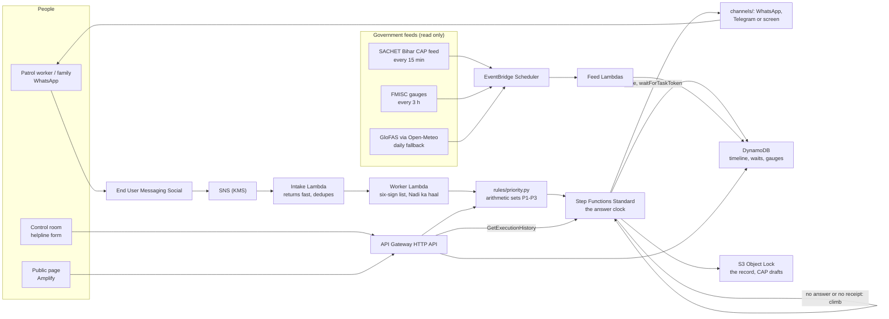

# Architecture

One SAM template (`template.yaml`), one region (ap-south-1, Mumbai), Python 3.12 on arm64. Every AWS service has one job the product can't do without. The heart is the Step Functions clock: a page that isn't answered moves up on its own.

## The answer clock

`statemachine/incident.asl.json` is a Standard workflow, because only Standard workflows can wait for a task token. States are named in plain English, because the graph is shown on the public page and in the video.

1. **Open the incident** with the priority the rules set (`src/incident/open.py`).
2. **Warn at once** for a P1: "Taiyaar" (get ready) to the mukhiya, ward members and subscribed families, without waiting for anyone (`warn.py`).
3. **Page** the junior engineer (`page.py`). The task token is stored in DynamoDB under a short wait ID, and the WhatsApp buttons carry that ID. The wait uses `arn:aws:states:::lambda:invoke.waitForTaskToken` with `TimeoutSecondsPath`: 10 minutes in real use, 60 seconds on demo clocks.
4. **A missed page climbs**: assistant engineer, then executive engineer and the district control room, then the zone's flood-fighting force. A one-off EventBridge Scheduler schedule checks for a delivery receipt two minutes after each page; with none, the page fails as `Undelivered` and climbs without waiting out the clock (`delivery.py`).
5. **An answer** (`answer.py`) calls `SendTaskSuccess`. Then on site, warnings by level, hand-off and close (`dispatch.py`, `notify.py`, `handoff.py`, `close.py`).

Every step writes to the incident's timeline in DynamoDB. The public page reads it, and the run's own history (`GetExecutionHistory`) is shown state by state, so judges can see AWS working.

## Ways in

| Way in | Path |
| --- | --- |
| WhatsApp | End User Messaging Social → SNS → `src/intake/handler.py` (returns fast, hands off async) → `worker.py` |
| Telegram (fallback) | `POST /telegram/hook` → `src/intake/telegram_hook.py` |
| Control-room form | `POST /incidents` → `src/api/control.py` (role token) |
| Judge path | `POST /demo/runs`, `POST /demo/answer` → `src/api/demo.py`: fictional roster, phones drawn on the page, rate-limited |

Channel code lives only in `src/channels/`; everything else calls `channels.send_*()`. One stack parameter (`Channel`) switches between `screen`, `whatsapp` and `telegram`, and one (`Outbound`) stops every message to a real phone.

## Government data in and out

- **In:** SACHET's Bihar CAP feed (`src/gov/sachet.py`, deduped on the alert identifier), the department's gauge map service (`src/gov/fmisc.py`, keeps the last good reading, skips water levels of -4), GloFAS through Open-Meteo (`src/river/poll.py`).
- **Out:** CAP 1.2 drafts (`src/gov/cap.py`), served as `GET /cap/rss.xml` in SACHET's shape. Status is always `Exercise`; nothing is ever sent to SACHET.
- **For people:** "Nadi ka haal" (`src/river/nadi.py`): a village's name returns the nearest official reading in Hindi with its source and time, the helplines, and "a student project, not an official warning".

## The live map

`web/src/map/` draws the Haijalpur stretch as an isometric Madhubani diorama on a canvas, from a 56 × 46 grid of 200 m cells built from AWS Open Data by `tools/build_map.py`: Copernicus DEM GLO-30 for height, ESA WorldCover 2021 for land cover, and the least cloudy Sentinel-2 L2A pass (via Earth Search) for observed water. The flood what-if, routes and relief clock run in the browser (`flood.ts`, `sim.ts`); with `VITE_API_BASE` set the page reads help requests and teams from the API every 4 seconds. The daily satellite Lambda and the help run on the server are specified in `docs/SPEC.md` ("The live map") and are being finished.

## Settings that matter to a government

- Data and compute in ap-south-1, a MeitY-empanelled region.
- KMS on the SNS topic; S3 Object Lock (governance mode) and versioning on the record bucket.
- Every log group kept 180 days.
- One IAM role per function, no managed policies. The only `Resource: "*"` entries are the ones IAM can't scope, listed with reasons at the top of `template.yaml`.
- Secrets and phone numbers only in SSM Parameter Store.

## Cost, one district for one monsoon

An estimate from AWS's published prices, for 150 km of embankment, 150 patrol workers, 20 high-water nights with five roll-calls each, 500 reports and 150 incidents: about **$155 a season**, most of it WhatsApp messages ($115), plus Meta's fee on template messages. Lambda, DynamoDB on demand and pay-per-message WhatsApp cost almost nothing from November to May.
